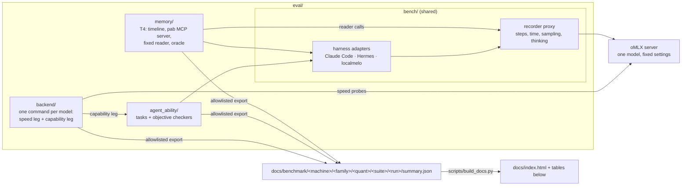

# personal_agent_eval_pipeline

A pipeline for evaluating local models as the backend of a personal agent on a Mac with Apple silicon.
Each suite runs under a fixed, versioned setting (a protocol), so a new model or quantization can be put
next to the ones already measured with one command, and anyone can rerun it on their own machine.

- **backend**: what an agent waits for (cached and cold time to first token, decode speed from 16K to
  110K context, a 20-step trajectory, memory), plus a functional gate and tool-call accuracy.
- **agent_ability**: whether agents built on the model get work done. The same tasks, with
  byte-identical prompts, run through three harnesses (Claude Code, Hermes Agent, localmelo) and are
  scored by objective checkers (MCPMark filesystem tasks, Aider polyglot exercises).
- **memory**: whether an agent keeps a correct, current and compact memory. A synthetic 10-day timeline
  is fed one day at a time; then a fixed reader answers probe questions from the memory store alone
  (T4).

Results: the [results page](https://xthomaswang.github.io/personal_agent_eval_pipeline/) (GitHub Pages,
from `docs/index.html`) and the tables below, per machine.

## Architecture



- Every model request of every harness goes through the recorder proxy, which counts agent steps and
  model time the same way for all three harnesses and enforces the sampling and thinking settings.
- Results are comparable only on the same machine and under the same protocol (tasks, budgets,
  sampling, thinking, server settings). Each result records both, and no table mixes them.
- backend's timed units wait for a quiet machine (no other GPU or heavy CPU load) and enough battery;
  the untimed suites need only the model server.

## Layout

```
eval/              all evaluation code
  backend/         per-model runs: model registry (models.toml), prepare, speed leg, capability leg, report
  agent_ability/   the harness task suite (MCPMark filesystem easy, Aider polyglot Python) and checkers
  memory/          T4 memory consolidation: generator, fixtures, pab MCP server, reader, oracle
  bench/           shared: recorder proxy (docs/proxy.md), harness adapters, run manifest
  customize/       your own private tasks: gitignored, never pushed
docs/              index.html (results page), benchmark/ (results), proxy.md
scripts/           build_docs.py
runs/              local run records (gitignored)
```

## Running

Needs macOS on Apple silicon, [uv](https://docs.astral.sh/uv/), [oMLX](https://github.com/jundot/omlx)
and, for agent_ability, the three harnesses. Each suite's README lists its requirements and settings.

```sh
(cd eval && uv sync)                                   # Python 3.13: bench/ and memory/
(cd eval/backend && uv run modeleval plan <model>)     # add the model to eval/backend/models.toml first
(cd eval/backend && uv run modeleval run <model>)      # speed + capability legs
(cd eval && uv run pytest -q)                          # offline self-tests (no server, no GPU)
python3 scripts/build_docs.py                          # rebuild docs/index.html and the tables below
```

- **A new model:** add a `[models.<key>]` entry to `eval/backend/models.toml` (served id, checkpoint,
  exact Hugging Face revision, quantization, speculative decoding, recommended sampling), prepare the
  checkpoint (`modeleval download`, `convert`, `register`), then `modeleval run <model>`. Its rows land
  under `docs/benchmark/<machine>/<family>/<quant>/`.
- **A new machine:** results go under a new machine id, and the reference model is run there first, so
  every other model has something to be compared with.

## Privacy

Only synthetic or public task data and allowlisted result fields are committed. Run records, harness
homes and transcripts stay in `runs/`, and tasks on your own accounts, messages or mail go in
`eval/customize/`; both are gitignored. Before anything is pushed, `eval/backend/scripts/redact.py --check`
must pass on the changed files: it refuses home paths, host names, private addresses and machine ids.

## Status (2026-10-26)

Assembled on 2026-10-26 from three local projects: agent-model-eval (`eval/backend/`, with its history),
harness-smoke (`eval/agent_ability/`) and personal-agent-bench (`eval/bench/`, `eval/memory/`). The backend
reads its machine paths from `eval/backend/config.defaults.toml` (local overrides in `config.toml`), takes
the GPU lock only where the lock protocol is configured, writes its runs under `docs/benchmark/`, and
snapshots its harness epoch from this repository (`eval/bench`, `eval/agent_ability`). In progress: T4's
harness runner.

## Results

<!-- results:start -->

**Backend, `m5max-40c-128gb`: Quantization fidelity against BF16, and screenshot reading** (`quant-fidelity-v0`)

| Model | KL, all stable positions | Top-1 agreement | KL, agent assistant turns | Top-1, agent turns | Screenshot codes read | Date |
|---|---|---|---|---|---|---|
| [Qwen3.8-27B oQ4 + MTP](docs/benchmark/m5max-40c-128gb/qwen3.8_27b/oq4/backend/2026-10-21-quant-compare/) | 0.216 | 91.7% | 0.016 | 96.2% | 54/60 | 2026-10-21 |
| [Qwen3.8-27B oQ5 + MTP](docs/benchmark/m5max-40c-128gb/qwen3.8_27b/oq5/backend/2026-10-21-quant-compare/) | 0.093 | 95.4% | 0.005 | 97.9% | 54/60 | 2026-10-22 |
| [Qwen3.8-27B oQ6 + MTP](docs/benchmark/m5max-40c-128gb/qwen3.8_27b/oq6/backend/2026-10-21-quant-compare/) | 0.043 | 97.3% | 0.002 | 98.4% | 56/60 | 2026-10-22 |
| [Qwen3.8-27B oQ8 + MTP](docs/benchmark/m5max-40c-128gb/qwen3.8_27b/oq8/backend/2026-10-21-quant-compare/) | 0.013 | 98.5% | 0.001 | 99.2% | 54/60 | 2026-10-21 |

**Backend, `m5max-40c-128gb`: Speed on oMLX 0.7.1rc1 (M5 Max): text-only, agent sampling, thinking off** (`speed-1`)

| Model | 64K cold TTFT | Cached-prefix TTFT | Decode 16K | Decode 32K | Decode 64K | Decode 110K | 20-step agent trajectory | Peak server memory | Date |
|---|---|---|---|---|---|---|---|---|---|
| [Qwen3.8-27B oQ5 + MTP (reference)](docs/benchmark/m5max-40c-128gb/qwen3.8_27b/oq5/backend/20261026-062952/) | 111.4 s | 3.20 s | 55.1 tok/s | 51.0 tok/s | 41.9 tok/s | 36.9 tok/s | 133.4 s | 58.0 GiB | 2026-10-26 |
| [Nanbeige4.3-33B oQ5](docs/benchmark/m5max-40c-128gb/nanbeige4.3_33b/oq5/backend/20261026-104645/) | 210.6 s | 5.05 s | 15.9 tok/s | 13.5 tok/s | 10.5 tok/s | 9.0 tok/s | 328.5 s | 74.0 GiB | 2026-10-26 |

**Agent ability, `m5max-40c-128gb`: Aider, 12 Python exercises x 3 harnesses, one run each (thinking off)** (`aider12-v0`)

| Model | Total | Claude Code | Hermes | localmelo | Date |
|---|---|---|---|---|---|
| [Qwen3.8-27B oQ4 + MTP](docs/benchmark/m5max-40c-128gb/qwen3.8_27b/oq4/agent_ability/2026-10-21-quant-compare/) | 27/36 | 7/12 | 11/12 | 9/12 | 2026-10-21 |
| [Qwen3.8-27B oQ5 + MTP](docs/benchmark/m5max-40c-128gb/qwen3.8_27b/oq5/agent_ability/2026-10-21-quant-compare/) | 32/36 | 9/12 | 12/12 | 11/12 | 2026-10-22 |
| [Qwen3.8-27B oQ6 + MTP](docs/benchmark/m5max-40c-128gb/qwen3.8_27b/oq6/agent_ability/2026-10-21-quant-compare/) | 31/36 | 9/12 | 11/12 | 11/12 | 2026-10-22 |
| [Qwen3.8-27B oQ8 + MTP](docs/benchmark/m5max-40c-128gb/qwen3.8_27b/oq8/agent_ability/2026-10-21-quant-compare/) | 33/36 | 10/12 | 11/12 | 12/12 | 2026-10-21 |

**Agent ability, `m5max-40c-128gb`: Claude Code, Hermes, localmelo on Aider 12 + MCPMark easy 10 (gate set) and Aider 22 (ranking set); thinking off** (`capability-1`)

| Model | Claude Code (gate) | Hermes (gate) | localmelo (gate) | Gate set | Ranking set | M7 tool-call cases | Date |
|---|---|---|---|---|---|---|---|
| [Qwen3.8-27B oQ5 + MTP (reference)](docs/benchmark/m5max-40c-128gb/qwen3.8_27b/oq5/agent_ability/20261026-062952/) | 21/22 | 20/22 | 22/22 | 63/66 | 61/66 | 21/22 | 2026-10-26 |
| [Nanbeige4.3-33B oQ5](docs/benchmark/m5max-40c-128gb/nanbeige4.3_33b/oq5/agent_ability/20261026-104645/) | 16/22 | 15/18 (partial) | — | 31/40 (partial) | — | 17/22 | 2026-10-26 |

<!-- results:end -->
