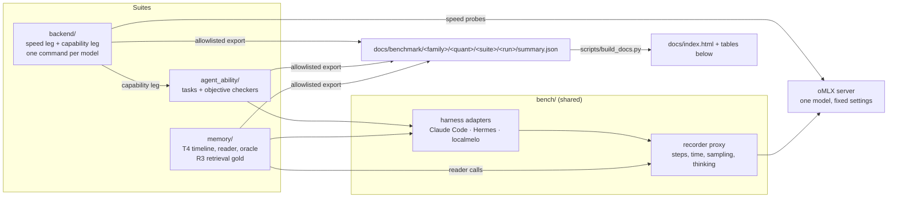

# personal_agent_eval_pipeline

Evaluates local models as the backend of a personal agent on one Mac (MacBook Pro M5 Max, 128 GB), with
fixed settings, so that a new model or quantization can be put next to the current one quickly. Three
suites:

- **backend**: what an agent waits for (cached and cold time to first token, decode speed from 16K to
  110K context, a 20-step trajectory, memory), plus a functional gate and tool-call accuracy.
- **agent_ability**: whether agents built on the model get work done. The same tasks, with
  byte-identical prompts, run through three harnesses (Claude Code, Hermes Agent, localmelo) and are
  scored by objective checkers (MCPMark filesystem tasks, Aider polyglot exercises).
- **memory**: whether an agent keeps a correct, current and compact memory: a synthetic 10-day timeline
  fed one day at a time, then probe questions answered by a fixed reader from the memory store alone
  (T4); and offline retrieval quality on recorded agent runs (R3).

Results: [docs/index.html](docs/index.html) (served by GitHub Pages) and the tables below.

## Architecture



- Every model request of every harness goes through the recorder proxy, which counts agent steps and
  model time the same way for all three harnesses and enforces the sampling and thinking settings.
- A run is comparable to another only under the same protocol (fixed tasks, budgets, sampling, thinking
  and server settings). Each result records its protocol, and the results tables never mix protocols.
- Timed work runs under one GPU lock shared by all suites, with quiet-machine and battery checks.

## Layout

```
backend/         model comparison (from agent-model-eval): registry (models.toml), prepare, speed leg,
                 capability leg, stats, report. Its own uv projects; see backend/README.md
agent_ability/   the harness task suite (MCPMark filesystem easy, Aider polyglot Python) and checkers;
                 see agent_ability/README.md
memory/          T4 (memory consolidation) and R3 (retrieval); in progress
bench/           shared: recorder proxy (docs/proxy.md), harness adapters, run manifest
docs/            index.html (results page), benchmark/ (results), proxy.md
scripts/         build_docs.py
customize/       the owner's private tasks (gitignored, never pushed)
tests/           bench/ tests (offline)
```

## Running

The machine needs oMLX, the three harnesses and the pinned data; `backend/README.md` and
`agent_ability/README.md` list them.

```sh
uv sync                                           # Python 3.13: bench/ and memory/
(cd backend && uv run modeleval plan <model>)     # a new model: add it to backend/models.toml first
(cd backend && uv run modeleval run <model>)      # speed + capability legs, under the GPU lock
uv run pytest -q tests agent_ability/tests        # offline self-tests
python3 scripts/build_docs.py                     # rebuild docs/index.html and the tables below
```

To add a model: add a `[models.<key>]` entry to `backend/models.toml` (served id, checkpoint, exact HF
revision, quantization, speculative decoding, recommended sampling), prepare the checkpoint
(`modeleval download`, `convert`, `register`), then `modeleval run <model>`. Its results land under
`docs/benchmark/<family>/<quant>/`.

## Privacy

Only synthetic or public task data and allowlisted result fields are committed. Run records, harness
homes, transcripts and anything from the owner's own accounts stay local (`runs/`, `private/`, both
gitignored). `backend/scripts/redact.py --check` is the check before anything is pushed.

## Status (2026-10-26)

The repository was assembled on 2026-10-26 from three local projects: agent-model-eval (`backend/`, with
its history), harness-smoke (`agent_ability/`) and personal-agent-bench (`bench/`, `memory/`). Still to
do before `backend/` and `agent_ability/` run from here:

- backend: in-repo paths for its harness epoch (it snapshotted `bench/`, `smoke/` and `shims/` from the
  old repos; their tree hashes are unchanged here), the localmelo pin, the redaction allowlist and the
  pre-commit hook, and writing `summary.json` under `docs/benchmark/`.
- agent_ability: `smoke/paths.py` still looks for `../personal-agent-bench` (set `PAB_ROOT` to this
  repository's root) and for the GPU lock next to its parent directory.
- memory: T4 is being built.

## Results

<!-- results:start -->

**Backend: Quantization fidelity against BF16, and screenshot reading** (`quant-fidelity-v0`)

| Model | KL, all stable positions | Top-1 agreement | KL, agent assistant turns | Top-1, agent turns | Screenshot codes read | Date |
|---|---|---|---|---|---|---|
| [Qwen3.8-27B oQ4 + MTP](docs/benchmark/qwen3.8_27b/oq4/backend/2026-10-21-quant-compare/) | 0.216 | 91.7% | 0.016 | 96.2% | 54/60 | 2026-10-21 |
| [Qwen3.8-27B oQ5 + MTP](docs/benchmark/qwen3.8_27b/oq5/backend/2026-10-21-quant-compare/) | 0.093 | 95.4% | 0.005 | 97.9% | 54/60 | 2026-10-22 |
| [Qwen3.8-27B oQ6 + MTP](docs/benchmark/qwen3.8_27b/oq6/backend/2026-10-21-quant-compare/) | 0.043 | 97.3% | 0.002 | 98.4% | 56/60 | 2026-10-22 |
| [Qwen3.8-27B oQ8 + MTP](docs/benchmark/qwen3.8_27b/oq8/backend/2026-10-21-quant-compare/) | 0.013 | 98.5% | 0.001 | 99.2% | 54/60 | 2026-10-21 |

**Agent ability: Aider, 12 Python exercises x 3 harnesses, one run each (thinking off)** (`aider12-v0`)

| Model | Total | Claude Code | Hermes | localmelo | Date |
|---|---|---|---|---|---|
| [Qwen3.8-27B oQ4 + MTP](docs/benchmark/qwen3.8_27b/oq4/agent_ability/2026-10-21-quant-compare/) | 27/36 | 7/12 | 11/12 | 9/12 | 2026-10-21 |
| [Qwen3.8-27B oQ5 + MTP](docs/benchmark/qwen3.8_27b/oq5/agent_ability/2026-10-21-quant-compare/) | 32/36 | 9/12 | 12/12 | 11/12 | 2026-10-22 |
| [Qwen3.8-27B oQ6 + MTP](docs/benchmark/qwen3.8_27b/oq6/agent_ability/2026-10-21-quant-compare/) | 31/36 | 9/12 | 11/12 | 11/12 | 2026-10-22 |
| [Qwen3.8-27B oQ8 + MTP](docs/benchmark/qwen3.8_27b/oq8/agent_ability/2026-10-21-quant-compare/) | 33/36 | 10/12 | 11/12 | 12/12 | 2026-10-21 |

<!-- results:end -->
